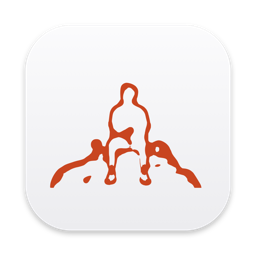

<p align="center">
  
</p>

<h1 align="center">TagSync</h1>

<p align="center">A tiny native macOS app that copies Finder tags from your JPEGs to the matching RAW files.</p>

---

Shoot RAW+JPEG, cull and tag the JPEGs in Finder (they preview fast), then let TagSync put the same tag on the RAW files so you can pull exactly those into your editor.

## How it works

TagSync is a single 360 × 360 window laid out like a calculator sheet: inputs on the left, live results on the right. Results update as soon as any input changes, and again whenever you switch back to the app, so tags you add in Finder show up straight away.

```
jpeg              Shiminami Kaido/JPEG
raw                Shiminami Kaido/RAW
tag                 Photos for Editing
──────────────────────────────────────
jpegs tagged                       128
raw matches                        124
already tagged                      20
DSC01234.ARW                         +
DSC01240.ARW                         ✓
──────────────────────────────────────
to tag                           104 ↩
```

1. **Click `jpeg`** (or drop a folder on it) to choose the JPEG folder. If a sibling folder called `RAW` exists, it's filled in automatically.
2. **Click `raw`** (or drop a folder on it) if a different RAW folder is needed.
3. **Click `tag`** to pick from your Finder favourite tags, plus any tag already used in the JPEG folder.
4. Press **Return** (or click the orange count) to tag the pending RAW files.

Details:

- Files are matched by name, ignoring case: `DSC01234.JPG` ↔ `DSC01234.ARW`.
- JPEG side: `jpg`, `jpeg`, `heic`, `heif`, `png`, `tif`, `tiff`.
- RAW side: `arw`, `cr2`, `cr3`, `nef`, `dng`, `raf`, `orf`, `rw2`, `pef`, `srw` and other common RAW formats. Sidecars like `.xmp` are left alone.
- Tags a RAW file already has are kept; the new tag is added alongside them.
- Only the top level of each folder is scanned (subfolders are ignored).
- Your last folders and tag are remembered between launches.
- Right-click a file in the list → **Reveal in Finder**.
- Follows the system light/dark appearance. Closing the window quits the app.

## Install

Download `TagSync-x.y.dmg` from [Releases](../../releases), open it, and drag **TagSync** to **Applications**.

The app isn't notarized by Apple, so the first launch is blocked by Gatekeeper. Either:

- right-click **TagSync** in Applications → **Open** → **Open**, or
- go to **System Settings → Privacy & Security** and click **Open Anyway**, or
- run `xattr -dr com.apple.quarantine /Applications/TagSync.app` in Terminal.

Requires macOS 14 (Sonoma) or later. Runs natively on Apple silicon and Intel.

## Build from source

Needs the Xcode command line tools (`xcode-select --install`). No Xcode project needed.

```bash
./build.sh            # builds TagSync.app
./build.sh --install  # also copies it to /Applications
./build.sh --dmg      # also creates dist/TagSync-<version>.dmg
```

## Project layout

```
Sources/TagSync.swift     the whole app (SwiftUI)
Assets/quintessence.svg   icon artwork
scripts/make-icon.swift   renders the artwork into the macOS app icon
build.sh                  compile, bundle, sign (ad-hoc), install, package
```

## The script it replaces

```bash
cd "/path/to/JPEG" || exit
for jpeg in *.JPG; do
  base="${jpeg%.JPG}"
  arw="../RAW/$base.ARW"
  if [ -f "$arw" ] && [ -n "$(tag --match "Photos for Editing" "$jpeg")" ]; then
    tag --add "Photos for Editing" "$arw"
  fi
done
```
